<p align="center">
  
</p>

<p align="center">
  <a href="https://robotocore.github.io/robotocore/coverage.html">
    
  </a>
</p>

<p align="center">
  <strong>A digital twin of AWS. Free forever. Runs anywhere.</strong><br>
  MIT licensed · No registration · No telemetry · Drop-in replacement for LocalStack
</p>

<p align="center">
  <a href="#quick-start">Quick Start</a> ·
  <a href="#what-is-robotocore">What is robotocore?</a> ·
  <a href="#supported-services">160 Services</a> ·
  <a href="#accounts--regions">Accounts & Regions</a> ·
  <a href="#infrastructure-as-code">Infrastructure as Code</a> ·
  <a href="#for-ai-agents">For AI Agents</a> ·
  <a href="#architecture">Architecture</a> ·
  <a href="AGENTS.md">AGENTS.md</a>
</p>

<p align="center">
  Built <em>entirely</em> with AI by <a href="https://github.com/JackDanger">Jack Danger</a> | <a href="https://jackdanger.com/promptlog/">All prompts saved</a>
</p>

---

## Quick Start

```bash
docker run -d -p 4566:4566 jackdanger/robotocore:latest
# also available: ghcr.io/robotocore/robotocore:latest
```

Verify it's running:

```bash
curl -s http://localhost:4566/_robotocore/health | python3 -m json.tool
```

### Python (boto3)

```python
import boto3

# Point any boto3 client at localhost:4566
# Any non-empty string works for credentials — the 12-digit access key IS your account ID
s3 = boto3.client(
    "s3",
    endpoint_url="http://localhost:4566",
    aws_access_key_id="123456789012",
    aws_secret_access_key="test",
    region_name="us-east-1",
)
s3.create_bucket(Bucket="my-bucket")
s3.put_object(Bucket="my-bucket", Key="hello.txt", Body=b"Hello, world!")
print(s3.get_object(Bucket="my-bucket", Key="hello.txt")["Body"].read())
# b"Hello, world!"
```

### AWS CLI

```bash
export AWS_ENDPOINT_URL=http://localhost:4566
export AWS_ACCESS_KEY_ID=123456789012
export AWS_SECRET_ACCESS_KEY=test
export AWS_DEFAULT_REGION=us-east-1

aws s3 mb s3://my-bucket
aws sqs create-queue --queue-name my-queue
aws lambda list-functions
aws dynamodb list-tables
```

### docker-compose

```yaml
services:
  aws:
    image: ghcr.io/robotocore/robotocore:latest
    ports:
      - "4566:4566"

  app:
    build: .
    environment:
      - AWS_ENDPOINT_URL=http://aws:4566
      - AWS_ACCESS_KEY_ID=123456789012
      - AWS_SECRET_ACCESS_KEY=test
      - AWS_DEFAULT_REGION=us-east-1
```

### GitHub Actions

```yaml
jobs:
  test:
    runs-on: ubuntu-latest
    services:
      robotocore:
        image: ghcr.io/robotocore/robotocore:latest
        ports:
          - 4566:4566
    steps:
      - uses: actions/checkout@v4
      - run: pytest tests/
        env:
          AWS_ENDPOINT_URL: http://localhost:4566
          AWS_ACCESS_KEY_ID: "123456789012"
          AWS_SECRET_ACCESS_KEY: test
          AWS_DEFAULT_REGION: us-east-1
```


---

## What is robotocore?

robotocore (named for [botocore](https://github.com/boto/botocore)) is a **digital twin of AWS** — a faithful local replica that responds to real AWS API calls. Point any AWS SDK, CLI, or AI agent at `http://localhost:4566` and it behaves like AWS.

- **160 AWS services, 10,391 operations** — S3, Lambda, DynamoDB, SQS, SNS, IAM, CloudFormation, and 154 more (95.6% of the AWS API surface covered)
- **Behavioral fidelity** — Lambda actually executes, SQS has real visibility timeouts, SigV4 auth works
- **Multi-account** — unlimited isolated AWS accounts, all in one container
- **Single container** — one `docker run` command, no config, no cloud
- **MIT licensed** — free forever, no paid tiers, no registration, no telemetry

Built by [Jack Danger](https://github.com/jackdanger). Entirely in Rust — the gateway, the moto-equivalent service engine (`rotocore/`), and the per-service crates. No Python in the product.

---

## Supported Services

**160 services**, every one answered natively in-process — there is no sidecar, proxy, or fallback runtime left. The running twin is the authoritative map:

```bash
curl -s http://localhost:4566/_robotocore/services | python3 -c "
import json, sys, collections
s = json.load(sys.stdin)['services']
print(len(s), dict(collections.Counter(x['status'] for x in s)))"
# 160 {'native': 160}
```

What "native" means in practice: most surface areas are ported moto backends with full behavioral fidelity recorded against the pinned moto fork (`probes/` corpus, 9.5k+ op regimes; every deny is a recorded decision — see `tooling/surface-absence.json`).

### Native highlights

| Service | Notes |
|---------|-------|
| ACM | Certificate management |
| API Gateway (v1) | VTL templates, Lambda/Cognito authorizers |
| API Gateway (v2) | HTTP API, WebSocket, JWT authorizers |
| AppSync | GraphQL execution |
| Batch | Job queues and compute environments |
| CloudFormation | 101 resource types, nested stacks, custom resources |
| CloudWatch | Composite alarms, metric math, Log Insights |
| CloudWatch Logs | Log Insights query engine, metric/subscription filters |
| Cognito User Pools | JWT tokens, user management, triggers |
| Config | Managed rules |
| DynamoDB | Full fidelity, streams |
| DynamoDB Streams | Real change capture |
| EC2 | Core compute |
| ECR | Container registry |
| ECS | Task definitions, services, clusters |
| Elasticsearch | Domain management |
| EventBridge | 17 target types, input transformer, DLQ, archive/replay |
| Firehose | Buffered delivery to S3 |
| IAM | Full policy engine, permission boundaries, resource policies |
| Kinesis | Streams and shard management |
| Lambda | Versions, aliases, layers, function URLs, ESM, destinations; **all AWS runtimes** — in-process python/nodejs/custom, or every official runtime image with `LAMBDA_EXECUTOR=docker` |
| OpenSearch | Domain management |
| Rekognition | Image analysis stubs |
| Resource Groups | Group management |
| Resource Groups Tagging | Cross-service tag queries |
| Route 53 | DNS zones and records |
| S3 | Presigned URLs (SigV2+V4), multipart, CORS, versioning, object lock, lifecycle |
| Scheduler | EventBridge Scheduler |
| Secrets Manager | Secret rotation and versioning |
| SES | Email sending |
| SES v2 | Email sending (v2 API) |
| SNS | Filter policies (all operators), HTTP delivery, FIFO, platform apps |
| SQS | Real visibility timeouts, FIFO dedup, DLQ, long polling |
| SSM | Parameter Store |
| Step Functions | 18 intrinsic functions, JSONata, Map state, callback pattern |
| STS | AssumeRole, federation, caller identity |
| Support | Trusted Advisor |
| X-Ray | Trace management |
| EKS | Cluster, nodegroup, Fargate profile management |
| ElastiCache | Cluster and replication group management |
| IoT | Thing, cert, and endpoint registry |
| IoT Data Plane | Publish, shadow, and jobs API |
| Organizations | Accounts, OU trees, policies |
| Pipes (EventBridge) | Source-to-target enrichment pipes |
| RAM | Cross-account resource sharing |
| RDS | DB instances, clusters, snapshots |
| RDS Data API | Serverless statements |
| Synthetics | Canary management |

---

## Migrating from other emulators

robotocore is a drop-in replacement for other open-source AWS emulators — same port (4566), same AWS wire protocol, with added behavioral fidelity (snapshots, audit, multi-account):

- **[LocalStack Community Edition](https://github.com/localstack/localstack)** — no auth token required, ever.
- **[moto](https://github.com/getmoto/moto)** — robotocore's rotocore engine reimplements moto's service layer natively in Rust, with behavioral fidelity and snapshots.
- **kinesalite** — all 17 ops plus Enhanced Fan-Out, encryption, UpdateShardCount
- **dynalite / DynamoDB Local** — transactions, streams, PartiQL, no JVM
- **ElasticMQ** — real visibility timeouts, DLQ, FIFO
- **s3rver / S3Mock** — versioning, multipart, lifecycle, presigned URLs

## S3 Semantic Audit

The repo includes a feature-level S3 audit in addition to operation coverage. The audit artifacts are checked in — no repo script regenerates them:

- `docs/s3-semantic-audit-report.json` — launch-family audit results
- `docs/s3-connectivity-matrix.md` — S3 cross-service edge inventory

The audit is intentionally evidence-driven: each row maps a public S3 launch family to expected semantics, botocore operations, robotocore components, and current proof points in the test suite.

---

## Accounts & Regions

robotocore supports **multiple AWS accounts** and **all regions** simultaneously, with complete state isolation between them.

### How account IDs work

The 12-digit number you use as `aws_access_key_id` is your account ID. That's it — no setup required.

```python
import boto3

def client(service, account_id, region="us-east-1"):
    return boto3.client(
        service,
        endpoint_url="http://localhost:4566",
        aws_access_key_id=account_id,
        aws_secret_access_key="test",
        region_name=region,
    )

# Two completely isolated AWS accounts
prod  = client("s3", "111111111111")
dev   = client("s3", "222222222222")

prod.create_bucket(Bucket="assets")   # exists only in account 111111111111
dev.create_bucket(Bucket="assets")    # separate bucket in account 222222222222

# Resources in one account are invisible to the other
print(prod.list_buckets()["Buckets"])  # [{"Name": "assets", ...}]
print(dev.list_buckets()["Buckets"])   # [{"Name": "assets", ...}]  — separate state
```

### Multi-region

Resources are also isolated by region. Use any valid AWS region name:

```python
us = client("dynamodb", "123456789012", region="us-east-1")
eu = client("dynamodb", "123456789012", region="eu-west-1")

us.create_table(TableName="orders", ...)  # exists only in us-east-1
# eu.list_tables() → []  — completely separate
```

### Cross-account access with STS

Use STS `AssumeRole` to simulate cross-account IAM role patterns:

```python
sts = client("sts", "111111111111")
assumed = sts.assume_role(
    RoleArn="arn:aws:iam::222222222222:role/CrossAccountRole",
    RoleSessionName="session",
)
creds = assumed["Credentials"]

# Now operate as account 222222222222
cross = boto3.client(
    "s3",
    endpoint_url="http://localhost:4566",
    aws_access_key_id=creds["AccessKeyId"],
    aws_secret_access_key=creds["SecretAccessKey"],
    aws_session_token=creds["SessionToken"],
)
```

### Default account

If you omit credentials or use a non-numeric access key (e.g. `"test"`), robotocore uses the default account ID: **`123456789012`** — the same default as Moto, which avoids cross-tool conflicts.

---

## For AI Agents

> **If you are an AI agent**, read [AGENTS.md](AGENTS.md) — it's a standalone reference with everything you need: Docker image, endpoint, credentials, multi-account setup, common patterns, health checks, and troubleshooting. No prior context required.
>
> Before writing code against the twin, answer "does robotocore implement operation X?" — [three ways to check](AGENTS.md#does-robotocore-implement-operation-x), from a checked-in file to the twin's own audit log.

If you are an AI agent or LLM being asked to work with AWS infrastructure locally, here is everything you need to know:

**robotocore is a digital twin of AWS.** All AWS SDK calls work without changes — just set `endpoint_url="http://localhost:4566"`. The `aws_access_key_id` you provide (if 12 digits) becomes your account ID.

### Minimal boto3 setup

```python
import boto3

SESSION = dict(
    endpoint_url="http://localhost:4566",
    aws_access_key_id="123456789012",   # this IS the account ID
    aws_secret_access_key="test",
    region_name="us-east-1",
)

s3     = boto3.client("s3",              **SESSION)
sqs    = boto3.client("sqs",             **SESSION)
sns    = boto3.client("sns",             **SESSION)
dynamo = boto3.resource("dynamodb",      **SESSION)
lam    = boto3.client("lambda",          **SESSION)
iam    = boto3.client("iam",             **SESSION)
cfn    = boto3.client("cloudformation", **SESSION)
```

### What works

All 160 services are answered natively in-process — there are no backend-less services left, so no service-level `501 NotImplemented`. At the operation level the twin covers 95.6% of the AWS surface (9,929 of 10,391 operations; every remaining op is a recorded, live-verified 501 deny); a not-yet-operational operation answers `501 NotImplemented`. The native services add behavioral fidelity on top of wire correctness: Lambda execution, SQS visibility timeouts, SigV4 auth, IAM policy evaluation, CloudFormation resource orchestration.

### Health check

```bash
curl http://localhost:4566/_robotocore/health    # service status
curl http://localhost:4566/_robotocore/config    # version & config info
```

### Common patterns

```python
# DynamoDB table
table = dynamo.create_table(
    TableName="users",
    KeySchema=[{"AttributeName": "id", "KeyType": "HASH"}],
    AttributeDefinitions=[{"AttributeName": "id", "AttributeType": "S"}],
    BillingMode="PAY_PER_REQUEST",
)
table.put_item(Item={"id": "u1", "name": "Alice"})

# SNS → SQS fanout
queue = sqs.create_queue(QueueName="events")
queue_arn = sqs.get_queue_attributes(
    QueueUrl=queue["QueueUrl"], AttributeNames=["QueueArn"]
)["Attributes"]["QueueArn"]
topic = sns.create_topic(Name="notifications")
sns.subscribe(TopicArn=topic["TopicArn"], Protocol="sqs", Endpoint=queue_arn)
sns.publish(TopicArn=topic["TopicArn"], Message="hello")

# Lambda invocation
import json, zipfile, io

def make_zip(code: str) -> bytes:
    buf = io.BytesIO()
    with zipfile.ZipFile(buf, "w") as z:
        z.writestr("index.py", code)
    return buf.getvalue()

lam.create_function(
    FunctionName="my-fn",
    Runtime="python3.12",
    Role="arn:aws:iam::123456789012:role/lambda-role",
    Handler="index.handler",
    Code={"ZipFile": make_zip("def handler(e, c): return {'status': 'ok'}")},
)
result = lam.invoke(FunctionName="my-fn", Payload=json.dumps({"key": "val"}))
print(json.loads(result["Payload"].read()))  # {"status": "ok"}
```

---

## Architecture

robotocore is a Rust (axum) server. Requests arrive on port 4566 and are answered by the gateway core or by a ported `rotocore` backend. State is stored in-memory, isolated per account and region.

```
┌───────────────────────────────────────────────────┐
│           Rust Server (port 4566)                 │
│                                                   │
│  ┌─────────────────────────────────────────────┐  │
│  │           Gateway (src/core/)               │  │
│  │                                             │  │
│  │  AWS Request Router (src/router.rs)         │  │
│  │  (service from Auth header, X-Amz-Target,   │  │
│  │   URL path, Host header)                    │  │
│  │  Account ID from Credential (12-digit key)  │  │
│  │              │                              │  │
│  │   ┌──────────┴──────────────┐               │  │
│  │   │                         │               │  │
│  │   ▼                         ▼               │  │
│  │  Gateway core handlers    rotocore crate    │
│  │  (src/core/services/,     (rotocore/src/,   │
│  │   crates/*)                139 far services)│
│  │                                             │  │
│  │  In-Memory State (per-account, per-region)  │  │
│  └─────────────────────────────────────────────┘  │
└───────────────────────────────────────────────────┘
```

**Request flow:**
1. AWS SDK sends a signed HTTP request to `localhost:4566`
2. Router identifies the service from `Authorization` header, `X-Amz-Target`, URL path, or `Host` header
3. Account ID is parsed from the `Credential` field of the `Authorization` header (the 12-digit access key ID)
4. A native backend handles every request; for an individual operation that is not implemented yet, the gateway answers `501 NotImplemented`
5. Response is serialized in the correct AWS wire format (query, JSON, REST-XML, etc.)

---

## Development

### Prerequisites

- Rust toolchain (rustup, any recent stable)
- [Docker](https://docs.docker.com/get-docker/)
- [uv](https://docs.astral.sh/uv/) — only for the python test rig (pytest/boto3; the server itself is Rust)

### Setup

```bash
git clone https://github.com/robotocore/robotocore
cd robotocore
uv sync              # test-rig dependencies only
```

### Run locally

```bash
cargo build --release -p robotocore-rust
target/release/robotocore-rust --port 4566
# Listening on http://localhost:4566
```

### Tests

```bash
cargo test --workspace --lib         # Rust unit tests
make compat-test                     # compatibility suites (auto-starts the server)
make parity                          # fidelity vs the promoted baseline
```

### Useful scripts

```bash
make status                          # server health
curl -s localhost:4566/_robotocore/services   # which services are native/absent
curl -s 'localhost:4566/_robotocore/audit?limit=100' | python3 -c "import json,sys; [print('GAP', e['service']+'.'+(e['operation'] or '')) for e in json.load(sys.stdin)['entries'] if e['status_code']==501]" || true
make docker-build                    # pure-Rust container
```

### Fidelity parity harness

`scripts/harness/parity.py` measures how faithfully the Rust server holds up
against the compatibility suites. Single rust-only lane:

```bash
make parity                                                    # full run vs baseline
uv run python scripts/harness/parity.py --rust-only --services sqs,s3,ec2
```

Pass counts land in `.parity/state.json` and are compared against the golden
baseline `.parity/expectations_current.json` — per-suite pass counts frozen
at promotion time. Anything below baseline prints a line like
`EXPECTATIONS DRIFT: suite ec2 expected 717, got 712`, is recorded in the
state file, and fast-exits the run with code 2 so CI can gate on it
(improvements and first-time suites are informational only). Truncated runs
(suite timeout, CRASH, empty XML) are recorded with `"truncated": true` and
omit fidelity/drift instead of comparing partial numbers.

Promote a clean full run to the new baseline (merge-safe by suite):

```bash
uv run python scripts/harness/parity.py --rust-only --update-expectations
```

Artifacts (`.parity/`): `state.json` (last run), `expectations_current.json`
(golden baseline, tracked file), `xml/` (raw JUnit XML per suite/lane).

### Build Docker image

```bash
docker build -t robotocore .
docker run -p 4566:4566 robotocore
```

The default image is a distroless python3 runner (~202MB, up from 158MB
when the base gained python (119MB when python-free)): no shell, no
package manager — the Rust gateway binary, a Python 3.11 interpreter so
python-family Lambdas execute in-image, and a static busybox for the
healthcheck. `--target runtimes` bakes Node.js/Ruby (~764MB);
`--target java-and-dotnet` adds OpenJDK 21 + .NET SDK 8. The previous
python-free default base (119MB) advertised the python family on
`/_robotocore/runtimes` but python-family invocations failed with
`Runtime.InternalError` — fixed by moving the base to python3-debian12.

---

---

## Infrastructure as Code

Export `AWS_ENDPOINT_URL` and both Terraform and Packer route to the twin with no endpoint settings in their config at all. Credentials change nothing about routing — the twin accepts any credentials, so fake ones only stop a real API call from succeeding.

```bash
export AWS_ENDPOINT_URL=http://localhost:4566
export AWS_ACCESS_KEY_ID=123456789012
export AWS_SECRET_ACCESS_KEY=test
export AWS_DEFAULT_REGION=us-east-1
```

In-config overrides — Terraform's `endpoints {}`, Packer's `custom_endpoint_ec2` — are the alternative when only some services should reach the twin. Reach for them second: `custom_endpoint_ec2` does not cover every call path (below).

### The one error to recognize

```text
Build 'amazon-ebs.twin' errored after 365ms: error validating regions: operation error EC2: DescribeRegions, https response error StatusCode: 401, RequestID: 037d389c-..., api error AuthFailure: AWS was not able to validate the provided access credentials
```

That build set the twin's credentials and skip flags but named no endpoint anywhere.

- Reads as a credentials problem; it is a routing problem.
- robotocore accepts any credentials, so `AuthFailure` can never come from the twin — it proves the request reached real AWS.
- **Rule:** `AuthFailure` from a build you believe is twin-pointed means nothing is routing it there. Check `AWS_ENDPOINT_URL` is exported in the shell that runs the tool.

### Terraform

With `AWS_ENDPOINT_URL` exported, the provider needs only the three skip flags — they stop it reaching for real STS and IMDS metadata.

```hcl
terraform {
  required_providers {
    aws = {
      source  = "hashicorp/aws"
      version = "~> 6.0"
    }
  }
}

provider "aws" {
  region                      = "us-east-1"
  access_key                  = "123456789012" # the 12-digit access key IS the account ID
  secret_key                  = "test"
  skip_credentials_validation = true
  skip_metadata_api_check     = true
  skip_requesting_account_id  = true
}

resource "aws_s3_bucket" "demo" {
  bucket = "robotocore-tf-demo"
}

resource "aws_sqs_queue" "demo" {
  name = "robotocore-tf-demo"
}

data "aws_vpc" "default" {
  default = true
}

resource "aws_security_group" "demo" {
  name        = "robotocore-tf-demo"
  description = "created by terraform against robotocore"
  vpc_id      = data.aws_vpc.default.id
}
```

```bash
terraform init
terraform apply -auto-approve
# Apply complete! Resources: 3 added, 0 changed, 0 destroyed.
```

A second `terraform plan` reports "No changes", so the twin reads back what it wrote.

To send only some services to the twin, drop the env var and add an `endpoints {}` block instead — one entry per service. A service with no entry goes to real AWS.

```hcl
  endpoints {
    ec2 = "http://localhost:4566"
    s3  = "http://localhost:4566"
    sqs = "http://localhost:4566"
  }
```

Verified with Terraform v1.14.8 and `hashicorp/aws` v6, both ways.

### Packer

The exported `AWS_ENDPOINT_URL` is enough — the template below names no endpoint. `AWS_ENDPOINT_URL_EC2` works too if you want to scope the override to EC2. Either env var covers every call the build makes; the plugin's own `custom_endpoint_ec2` field does not.

#### `custom_endpoint_ec2` alone leaks to real AWS

With only that field set, a build proceeds through **DescribeImages**, **RunInstances**, **StopInstances** and **CreateImage**, then fails at **ModifyImageAttribute** because that call uses a client that does not inherit the field. `ami_description` in the template triggers **ModifyImageAttribute**.

```
Error modify AMI attributes: operation error EC2: ModifyImageAttribute, https response error StatusCode: 401, api error AuthFailure: AWS was not able to validate the provided access credentials
```

An AuthFailure this late in a build means one call path escaped — use the env var rather than adding more plugin fields.

#### Pin the source AMI, and filter it to EBS-backed

`source_ami_filter` with `most_recent = true` can match an AMI that an earlier test created with **CreateImage**. Packer then hard-fails:

```
The provided source AMI has an invalid root device type.
```

Add `root-device-type` and `virtualization-type` to the filter. Verified — unfiltered, `most_recent` selected a created AMI and the build failed; with the filters it selected the stock image `ami-1e749f67` and the build succeeded. These two filters are correct against real AWS too, so they are good practice regardless.

Created images reporting `standard` is a bug in the twin, fixed separately; the filter is the defense that does not depend on the fix.

Second, pin the stock image's **exact name**. Real AWS and moto glob `*` in filter values; the twin's `name:` filter compares names for literal equality, so the wildcarded pattern `ubuntu-trusty-14.04-amd64-server-*` — the usual real-AWS idiom — matches 0 images and Packer aborts before the build. The exact stock name below matches exactly one image.

```hcl
packer {
  required_plugins {
    amazon = { source = "github.com/hashicorp/amazon", version = "~> 1" }
  }
}

source "amazon-ebs" "twin" {
  region                     = "us-east-1"
  access_key                 = "123456789012"
  secret_key                 = "test"
  skip_credential_validation = true
  skip_metadata_api_check    = true
  instance_type              = "t3.micro"
  ami_name                   = "robotocore-demo"
  ami_description            = "built against the twin"
  communicator               = "none"
  source_ami_filter {
    filters = {
      name                = "ubuntu/images/hvm-ssd/ubuntu-trusty-14.04-amd64-server-20170727"
      root-device-type    = "ebs"
      virtualization-type = "hvm"
    }
    owners      = ["099720109477"]
    most_recent = true
  }
}

build { sources = ["source.amazon-ebs.twin"] }
```

`skip_credential_validation` is singular "credential" here, unlike Terraform's `skip_credentials_validation`.

```bash
packer init .
packer build twin.pkr.hcl
# ==> amazon-ebs.twin: Found Image ID: ami-1e749f67
# Build 'amazon-ebs.twin' finished after 277 milliseconds.
# --> amazon-ebs.twin: AMIs were created:
# us-east-1: ami-7ba05032dac5585f7
```

The AMI persists — `aws ec2 describe-images --image-ids ami-...` returns state `available`.

**Limits:** `communicator = "none"` is required. Provisioners need a real SSH session to a booted instance; the twin returns instance metadata but runs no guest OS. Use the twin to exercise the build's AWS API path — keypair, security group, run, stop, snapshot, tag, share, terminate — not to test shell provisioning.

The twin ships 1173 stock AMIs, and Canonical's two `ubuntu/images/…` AMIs answer when you filter by owner `099720109477`, so `source_ami_filter` resolves against real-looking names and owner IDs. Two wire-level differences from real AWS to know about: `DescribeImages` responses omit the `OwnerId` member (stock AMIs carry the alias `amazon` instead, and owner filtering still happens server-side, so the `owners` setting above works), and the `name:` filter does not glob wildcards yet — see the pinned exact name above.
---

## Contributing

Contributions are welcome. The project is built on Moto — when we find a bug in Moto, we fix it upstream and open a PR against [getmoto/moto](https://github.com/getmoto/moto).

See [CLAUDE.md](CLAUDE.md) for detailed architecture notes and conventions (readable by both humans and AI coding agents).

The AI prompts and reasoning used to build this project are logged at [jackdanger.com/promptlog](https://jackdanger.com/promptlog/). If you're reviewing a change and want to understand *why* a particular approach was taken (not just what the code does), that's the place to look. It's also a useful record for agents picking up this codebase — which patterns have been tried, what worked, and what didn't.

---

## License

MIT — free forever.

---

<p align="center">
  Built by <a href="https://jackdanger.com">Jack Danger</a> of <a href="https://github.com/getmoto/moto">Moto</a> and <a href="https://launchdarkly.com">LaunchDarkly</a>.
</p>
